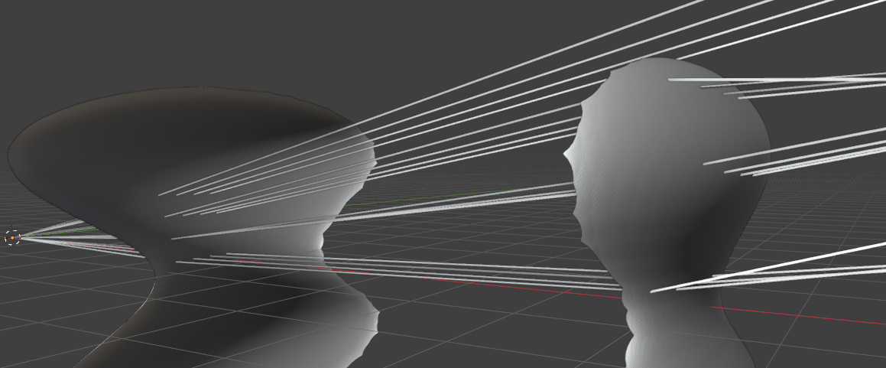

# Bézier triangle mesh raytracer

The aim of this project is to simulate image rendering of arbitrary-shaped "lenses" described by triangle meshes using Bézier triangle interpolation. It will be possible to simulate free-form lenses, and of course spherical lenses as well. (Of course, spherical lenses can be simulated much more efficiently.) This project is just for personal learning, so I omit the investigation of existing results.

This work is divided into 2 parts:
1. [C++ utilities and preprocessor](#1001). These parts check the input and produce the Bézier mesh appropriate to implement raytracing.
2. [A single ray tracing implementation in C++](#1002). I use it actually to develop all geometry and raytracing algorithms.

[Shortcomings](#1005) are here. I use Eigen3 for vector calculations and Google Test for unit testing. I also use Sebastian Reiter's STL reader utility to parse STL files.

[Here](https://bamer.hu/tdk/) is my ancient naive implementation of a spherical lens system simulator from 1994-1998 (in Hungarian). That work originates from the high school, with most parts ready then. I've abandoned the work because a 80386 without an FPU was far too slow for any meaningful rendering. During my university studies, I could complete it and use a Sun workstation for rendering the images.

## C++ utilities and preprocessor

<a id="1001">For</a> space and performance reasons, I use 3D Cartesian coordinates. Since most container sizes are known or calculable, I use `std::vector`s for simple storage.

### src/util.h

This file contains common type declarations for all other sources, some geometry calculations like plane creation and intersection, and triangle altitudes. There is also a simple uniform triangle subdivision function template.

### src/mesh.h

This is the home of the `Mesh` class. I know there are several good STL and mesh processing libraries, but I've created this class for several reasons:
1. I wanted full control over mesh processing.
2. I wanted to preserve original vertices. If the mesh creation algorithm is sophisticated enough, it knows better where and how to place vertices.
3. It contains important preprocessing steps for later stages, which belong to triangle mesh processing, not Bézier triangle meshes.
4. I enjoy working with geometry vectors.

The `Mesh` class exposes a set of STL vector-like interface functions for easier use. It also provides overloaded operators for displacement and inflation operations, STL file I/O. Here I only write about the more interesting functions.
Note, this class can only handle a mesh consisting of **exactly one connected** shape, which can be either totally filled (closed) or open.

#### Mesh::standardizeVertices

This function is used to make the vertices of different triangles coincide when they are practically the same mesh vertex, but have slightly different values due to different numerical errors. This will enable later functions to compare floating-point values for an identity check. Note, these comparisons only occur on the output of this function without any subsequent calculations. First, I calculate an epsilon value for proximity comparisons using the smallest triangle length. Since the naive implementation would be O(n^2), a more sophisticated algorithm is needed.

I solve the problem using 1D projections. For each dimension, I take the vertices in ascending order and group them based on whether they are closer to each other than epsilon. Pairwise proximity check will then only be needed in each group. I take the dimension where the maximum group size is minimal (less degenerate projection) and then perform the pairwise check. I adjust each vertex pair to the smaller one according to an artificial alphabetical ordering of the coordinates.

#### Mesh::standardizeNormals

This function makes all triangle normals point outwards if calculated as `(triangle[1] - triangle[0]).cross(triangle[2] - triangle[0])` (note: `using Triangle = std::array<Vertex, 3u>`). This function must be used after `Mesh::standardizeVertices`, and assumes that there is no triangle vertex on the side of another triangle. The algorithm is roughly
1. Find a vertex with the smallest X coordinate.
2. Find a neighbouring triangle with the smallest x component (negative for all such triangles).
3. Make this triangle good by possibly swapping two vertices.
4. Create a set of triangles with the side neighbours of this initial triangle, marking their known good neighbour as well.
5. Take a triangle from the set, make it good using the info from its known neighbour.
6. Put its unprocessed neighbours into the set.
7. Loop to 5. if the set is not empty.

This function also gathers auxiliary data for later stages, see below.

#### Mesh::standardizeNormals(Vector const &aFrontDirection)

This variant also accepts open meshes, where "outwards" has no meaning. Instead, the initial triangle will be the one facing most in (or against) `aFrontDirection`, and its normal will point to `aFrontDirection`. An edge belonging to only one triangle is on the rim: its neighbour index is `Mesh::csNoNeighbour`, and its vertices are collected in `getBoundaryVertices()`. As a vertex lying on the side of another triangle would look like a rim, too, I check every rim vertex against the rim edges. Both variants reject edges belonging to more than two triangles, and meshes consisting of more than one piece.

A triangle having none of its vertices on the rim is a *core* triangle (`Mesh::isCoreFace`). Its vertex normals are averages of complete fans, just like in a closed mesh.

#### Mesh::makeEllipsoid(int32_t const aSectors, int32_t const aBelts, Vector const &aSize)

Deletes all current contents and creates an ellipsoid with the given parameters. The triangle vertices will be on the ellipsoid surface. The ellipsoid is approximated somewhat similarly as the azimuth-inclination mesh on the Earth. There will be `aBelts` pieces of "belts" along each "parallel", each divided evenly by `aSectors` vertices. Between the belts, there are 2 * `aSectors` pieces of triangles, while between the extreme belts and poles, only `aSectors` pieces. The parameter aSize contains the principal semi-axes of the ellipsoid. There is also a special case called `makeUnitSphere` to create a unit sphere.

#### Mesh::getFace2neighbours

Returns an `std::vector<Neighbours>`, each item corresponding to a mesh triangle. Here, the struct `Neighbours` holds information about the neighbouring triangles of the actual one's each side (starting at vertex i within the triangle):
* mFellowTriangles for mesh index of the neighbour of the actual side (`i` -> `(i+1)%3`)
* mFellowCommonSideStarts for the vertex index `k` in each fellow triangle where the common side starts, such that the side in the neighbouring triangle (`k` -> `(k+1)%3`) is the same side as (`i` -> `(i+1)%3`).
Must be run after `Mesh::standardizeNormals`.

#### Mesh::getVertex2averageNormals

Returns a map of vertices to the "vertice normals", which will be the Bézier triangle normals in the vertices. "Vertex normals" are the weighted average of triangle normals containing the vertex, weighted by the triangle angles at that vertex. Must be run after `Mesh::standardizeNormals`. Perhaps it would be important to implement a way to import these values along with the triangles when the original surface is known and derivatives are present. This would enable a much more exact approximation.

### src/bezierTriangle.h

Here resides the `BézierTriangle` class, which is capable of
* Creating a Bézier triangle over a regular triangle, considering its neighbours, in a way that the neighbouring Bézier surfaces will give a surface with C1 continuity. [[1]](#1) I chose C1 because cubic Bézier triangles are sufficient for this, and the interpolation and thus the surface intersection calculations will be faster.
* Linear interpolation on the underlying planar triangle using barycentric coordinates within the underlying triangle.
* Bézier interpolation using barycentric coordinates within the underlying triangle.
* Ray and underlying planar triangle intersection with barycentric output.
* Ray and Bézier triangle intersection with barycentric output.
* Normal vector calculation on the barycentric triangle using barycentric coordinates.

The Bézier triangle will contain all the original triangle vertices. Control point calculations follow the Clough-Tocher split [[1]](#1) and its classic C1 conditions, in 4 passes over the mesh, because each pass needs the results of the previous one in the neighbouring triangles:
1. The constructor puts the control points of the original side at its thirds, lifted onto the tangent planes of the vertices given by the vertex normals. The triangle on the other side of the original side computes exactly the same.
2. Inside the original triangle, each control point next to a vertex is the average of its three neighbours around that vertex. Then the middle control point makes the derivative across the original side at its middle lie in the tangent plane there. This plane is perpendicular to the plane between the original neighbours, and contains the tangent of the common boundary curve, so it is the same for the triangle on the other side.
3. Each control point next to the centroid on a split side is the average of its three neighbours there.
4. The control point above the centroid is the average of its three neighbours.

The average rules make the surface exactly C1 inside the original triangle. Across the original sides, the common tangent planes at the vertices and at the middles make it C1 there, and approximately C1 in between. The control points of the original side are lifted from the flat original triangle along a direction given by `BezierMesh`:
* For an open mesh it is the average normal of the mesh, so the surface is a height field above a plane perpendicular to it. Such a surface is exactly C1 everywhere. This suits mirror-like surfaces, which have no steep parts relative to this direction.
* A closed mesh has no common direction, so these points are lifted perpendicularly to their target planes. The largest normal angle across the original sides was 0.09 degrees on a 21x15 unit sphere, but strongly concave and coarse meshes can still fold, like the waist of the bulged shape in the tests.

The class contains some precomputed values useful for intersection calculations, like maximum distances from the underlying triangle inside and outside.

#### BezierTriangle::intersectByBezierEvaluations

This is my old intersection function.

Theres is no closed formula for Bézier triangle and ray intersection, like there is for planes and spheres. There are existing ray - Bézier triangle intersection algorithms, such as [[2]](#2). The article does not contain performance data, and it seemed to me a big effort to implement it. So I've found out a rather simple algorithm based on Newton's method with one or two identical computation-intensive loops, which are easy to run parallel for many rays.

First, I check the intersection with the underlying planar triangle, and if it intersects, I calculate the lengths along the ray measured from its starting point
* until the ray reaches the signed distance from the underlying plane equal to the maximal surface point (of the Bézier triangle) above that plane
* until the ray reaches the signed distance from the underlying plane equal to the maximal surface point below that plane

The intersection calculation is performed in a fixed number of iterations, currently 4.

1. Set the starting point for the linear estimation of the ray and surface intersection based on their distance difference from the underlying plane at the above extremes. This is a point on the ray. If the point falls too far away or division by zero would occur, I take the extreme interval midpoint. TODO figure.
2. Set the initial projection direction to the underlying triangle normal.
3. Project the candidate point on the ray to the underlying plane in the projection direction. TODO figure.
4. Calculate its barycentric coordinates.
5. Use these to calculate the corresponding surface point and surface normal.
6. Set the new projection direction to the surface point - projected point vector. This greatly reduces the approximation error.
7. Take the plane in the surface point perpendicular to the surface normal and intersect it with the ray to get the next ray point to start from.
8. Goto 3 when there is iteration left.

This process is practically a modification of Newton's root finding method, with an indirect way of evaluating f(x) and f'(x) - exact calculation does not work without barycentric coordinates. The process practically always converges when the ray has not too big an angle of incidence. TODO exact proof for this based on [[3]](#3)

When ready, it is important to check if the intersection is within the domain of the current Bézier triangle. If not, the intersection would be more accurate when calculated on the appropriate neighbouring triangle. To enable this, in this case, I return the side index to be considered for a similar calculation process for the neighbouring triangle. Since its planar intersection will definitely be outside the underlying triangle, I omit that check to let the function finish. TODO figures.

Following from the algorithm, the intersection point will lie exactly on the Bézier surface. The relative accuracy of the intersection (so the distance of the intersection point from the ray, normalised by the shape size) is usually **3e-6**, but in the rare cases of bias divergence it can be as high as **2e-4**.

#### BezierTriangle::intersectKajiya

This is a faster and more precise alternative to the previous method, based on the idea of [[10]](#10). It uses the same early-out, planar triangle limit and neighbour classification steps.

The cubic Bézier triangle `S(u, v)` (with `u` and `v` the first two barycentric coordinates) is precomputed in power basis as `S(u, v) = Σ A_ij u^i v^j` for `i + j <= 3`, so its partial derivatives `S_u` and `S_v` are quadratic polynomials with coefficients readily available from the same 10 vectors `A_ij`.

The ray `o + t d` is regarded as the intersection of two planes containing it. Their normals `n1` and `n2` are perpendicular to `d` and to each other, so the planes are parallel to the ray and meet exactly in it. A surface point lies on the ray when it lies on both planes:

`f1(u, v) = n1 · S(u, v) - n1 · o = 0`  
`f2(u, v) = n2 · S(u, v) - n2 · o = 0`

Projecting the coefficients `A_ij` onto `n1` and `n2` once per ray gives two scalar cubic polynomials. Then a 2D Newton iteration solves the system for `(u, v)` using the 2x2 Jacobian `[[n1 · S_u, n1 · S_v], [n2 · S_u, n2 · S_v]]`, starting from the barycentric coordinates of the planar intersection. Each iteration is only scalar polynomial evaluation, without normalization or cross products. The intersection is accepted only when the Newton step becomes negligible. Finally the surface point `S(u, v)`, the ray parameter `t = d · (S(u, v) - o)` and the normal `S_u × S_v` are calculated once.

A direct Newton iteration on the single ray parameter `t` would need the implicit equation of the Bézier triangle, which is of degree 9 with 220 coefficients, numerically fragile and also has roots outside the triangle.

#### BezierTriangle::getNormal

This function is used in `BezierTriangle::intersectByBezierEvaluations` to calculate the surface normal in the intersection point. I used the principle described in [[4]](#4) to calculate closed-formula barycentric derivatives and use them to calculate two perpendicular surface tangent directions in that point. Their cross product gives the desired normal.

### src/bezierMesh.h

The `BezierMesh` class is similar to and based on the `Mesh` class, and is responsible for
* Constructing the Bézier triangle mesh of `BézierTriangle` instances in Clough-Tocher subdivision [[1]](#1), see later. Input is a plain triangle `Mesh`.
* Obtaining a triangular mesh approximation (`interpolate`) with evenly subdividing each subtriangle side into `aDivisor` parts.
* Split "thick" Bézier triangles into smaller, "thinner" ones.

#### Open meshes

For an open `Mesh`, only the core triangles become Bézier triangles. The outer ring of triangles serves only as neighbours: their planar normals determine the planes between neighbours along the new rim, and they complete the vertex normal fans. So the Bézier triangles of an open mesh are identical to those the same triangles would get in a bigger, even closed mesh, with no extrapolation involved. The price is that the input mesh needs one extra ring of triangles around the desired surface. A mask passed to the constructor can further restrict which core triangles are built.

#### BezierMesh::splitThickBezierTriangles

I've implemented this function because the ray tracing will inspect the mesh and ray intersections using the underlying triangle mesh (after Clough-Tocher subdivision). When we have the planar intersection, it will be used to calculate the ray intersection with the Bézier triangle above it. However, if the Bézier triangle forms a relatively too "tall" dome above the underlying triangle, it is more likely that a ray can travel through it without intersecting any planar triangle. Of course, it is still possible when the Bézier triangles are "close" to the underlying triangles, but much less likely. In such a rare case, the simulation will find the ray pass just right beside the object.

The idea here is to take all Bézier triangles, and subdivide each one proven to be too tall. Note, as we are in the Bézier triangle domain, each triangle is the result of the Clough-Tocher subdivision. I could have gone with taking that subdivision of the tall triangle, but it tends to create "thin" triangles, as the edges won't ever be split. I know there are well-known subdivision algorithms, but I wanted to make a very simple implementation and take advantage of the Bézier triangle control point information, which already takes into account the neighbouring triangles.

Currently, I take the approximate Bézier triangle height (maximum at the original triangle centroid and quarter points of the original sides) and the triangle perimeter ratio, and if it is larger than a constant, I will split it. It might be interesting to incorporate an absolute value parameter, too.

The algorithm is simple: I take the underlying side midpoints of a "tall" Bézier triangle, and divide it into 4 pieces. Now it creates vertices where the neighbouring triangle may not have on its sides (no need to split it), so I propagate the subdivision info across each edge to the neighbouring triangle, and split them accordingly into 2 or 3 pieces, for 1 or 2 neighbours being subdivided, respectively. TODO figures.

New (dividing) vertices are calculated as a fixed linear combination of the side midpoint of the underlying triangle edge and the Bézier interpolation of that point (which is "above" the underlying triangle). The linear combination factor has been found empirically, see below. The function gives back a new, finer `Mesh` instance, which then needs to be preprocessed again and used in the creation of a new, finer `BézierMesh`.

For an open mesh, the triangles not built are copied to the result, and split where a built neighbour requires it. Their dividing vertices come from the built neighbour, as the Bézier curve of the common side is the same. Such a triangle can share at most one side with the core, so it is only split into 2, and the outer ring survives the refinement.

#### BezierMesh::intersect

This is now only a simple brute-force search for the intersection giving the shortest ray.

Kajiya's method may converge to the polynomial continuation of a Bézier triangle far outside its domain. `BezierTriangle::classifyIntersection` lets such a point through when it is outside two divider planes, and as the closest one, it would replace the real intersection. So I reject intersections with a barycentric coordinate below `csMinBarycentricOfHit` (-0.2), as I have not seen real intersections below -0.1. Before this filter, 0.4% to 6% of the intersections on the test meshes were such false ones.

For open meshes, an intersection leading beyond the rim counts as no intersection. A ray hitting the surface close to the rim may cross the underlying plane just beyond the rim edge, where no neighbour catches it. So a Bézier triangle on the rim gets a second try without the planar limit, if the planar intersection is close beyond its rim edge. Without this, up to a third of the intersections near the rim would be lost even at moderate angles of incidence.

#### Ellipse approximation test

I've chosen an ellipsoid with principal semi-axes 1.0, 2.0 and 4.0 was used for these tests. I've chosen this shape because it somewhat resembles a lens, has curvatures with reasonably high variety in radii. I've measured the error of the interpolated mesh (`aDivisor` == 3) vertices relative to the ellipsoid surface point in the very same direction (where the line containing the centre and the vertex intersects the ellipsoid). Average quadratic relative errors were around **1.3e-5** for the raw ellipsoid with 15 sectors and 5 belts, and **6.3e-9** for the raw ellipsoid with 47 sectors and 17 belts. Further splits of the raw shape slightly increase the error.
I find these results good enough to start with. Should the error be too big for some application, a more specialised parameter tuning is possible, or I might use more sophisticated preprocessing algorithms.
There are general error limits for surface approximation using Bézier triangles, like in [[5]](#5). Here, for any triangle where the parametric function describing the surface to approximate is known and its second partial derivatives exist, an upper limit for the error can be expressed.

## C++ raytracer

<a id="1002">This</a> is just visualization for visual inspection in Blender.

### src/bezierLens.h

`BezierLens` now only contains the function below. The class is constructed with the refractive index and the `BezierMesh` giving its shape, or with two open `BezierMesh` surfaces bounding it, in the order of the light path. In both cases the surface normals must point out of the lens. A ray must enter through the first surface and leave through the last one (the same for a closed lens). If the closest intersection among all surfaces is not on this very next surface, the ray is terminated, as if it would hit the black tube holding the lenses.

#### BezierLens::refract

This is a simple implementation using relative indices of refraction according to [[6]](#6). Refraction only occurs if the ray intersects the contained shape, and handles inside-outside and outside-inside transitions automatically. To avoid uncertain intersections with large angles of incidence, the method accepts the expected "place" of ray (inside or outside). Should the intersection result be different, the method interprets it as no intersection. As Bézier surfaces allow quite precise normal calculation, the refraction precision depends on
- the surface approximation using the Bézier triangle mesh
- the intersection precision.

## Shortcomings

<a id="1005">In</a> theory, my algorithms can handle concave meshes, and the `Mesh` class even meshes with holes in it (with hole walls covered by triangles, so holes in a topological sense). In practice, I've tried some concave bodies, and the ones with small dihedral angles (< 90-120 degrees, depending on the situation) cause numeric errors, most probably because of the extreme variation between the sizes of neighbouring triangles and sharp edges.

Both intersection algorithms miss more and more mesh intersections as the angle of incidence grows, because they start from the intersection with the underlying planar triangle and follow at most one neighbour. The limit depends on the mesh density. On a coarse 7x3 unit sphere about 93% of the intersections are found at 60 degrees and 65% at 70 degrees. On a finer 21x15 unit sphere practically all are found up to 70 degrees, and 94% at 80 degrees. This could be fixed with some shallow recursion, but I leave it yet.

Analysis of the old intersection algorithm lacks exact mathematical proof. The new one is based on Kajiya's algorithm, which is mathematically well founded,

The refraction algorithm does not handle compound lenses. For open meshes, its inside and outside mean behind and in front of the oriented surface.

Open meshes need an extra ring of triangles around the desired surface, see [open meshes](#open-meshes). Extrapolating "phantom" triangles across the rim would spare this, but only with an approximate rim shape.

## References

See [Wikipedia](https://wikipedia.org) for well-known or simpler stuff.

<a id="1">[1]</a> 
Shaoming Wang (2004). 
A smooth surface interpolation to 3D triangulations
Journal of Computational and Applied Mathematics, Volume 163, Issue 11 (February 2004), pp 287–293

<a id="2">[2]</a> 
S.H.M. Roth, P. Diezi, M.H. Gross (2000).
Triangular Bezier clipping
Proceedings the Eighth Pacific Conference on Computer Graphics and Applications (October 2000)

<a id="3">[3]</a>
Ryaben'kii, Victor S.; Tsynkov, Semyon V. (2006).
A Theoretical Introduction to Numerical Analysis
CRC Press, p. 243, ISBN 9781584886075.

<a id="4">[4]</a>
Gerald Farin (1986).
Triangular Bernstein-Bézier patches
Computer Aided Geometric Design 3, pp 83-127

<a id="5">[5]</a>
Chang Geng-zhe, Feng Yu-yu (1983).
Error bound for Bernstein-Bézier triangulation approximation
Journal of Computational Mathematics Vol. 1, No. 4 (October 1983), pp. 335-340

<a id="6">[6]</a>
Scratchapixel
https://www.scratchapixel.com/lessons/3d-basic-rendering/introduction-to-shading/reflection-refraction-fresnel

<a id="7">[7]</a>
Cory Simon (2015).
Generating uniformly distributed numbers on a sphere
http://corysimon.github.io/articles/uniformdistn-on-sphere/

<a id="8">[8]</a>
Jack Ritter (1990).
An efficient bounding sphere
Versatec, Inc. Santa Clara, California

<a id="9">[9]</a>
Gluyas (2019).
Intersection of solid of revolution and a line
https://math.stackexchange.com/questions/1971374/intersection-of-solid-of-revolution-and-a-line

<a id="10">[10]</a>
James T. Kajiya (1982).
Ray tracing parametric patches
Computer Graphics (SIGGRAPH '82 Proceedings), Volume 16, Issue 3, pp 245-254
